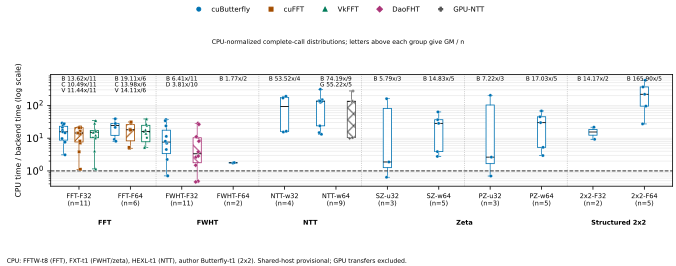

# cuButterfly

**Hierarchical hybrid tile-dataflow for butterfly computation on GPUs.**

cuButterfly is a CUDA research library for FFT, NTT, FWHT, structured 2×2,
and subset/superset zeta transforms. These operators share staged pair
dependencies, but their useful parallel shape changes with precision, rank,
batch, layout, direction and hardware resources. A fast arithmetic core alone
does not determine performance: the execution organization must decide what is
expanded across independent tiles, what is reused across time, and how each
stage hands data to its consumers.

## Method at a glance

cuButterfly expresses that organization as a **hierarchical hybrid tile-dataflow
graph**. A request is lowered into legal tile subgraphs, matched to a replaceable
arithmetic core, and checked against the target's measured storage, bandwidth and
concurrency constraints.

1. **Expose dependencies.** Stage relations define local work and the values
   exchanged with successor regions.
2. **Choose a hybrid organization.** Independent tiles provide spatial work;
   bounded tile residency and reuse provide temporal work. The number of active
   bands, tile shape, layout and pipeline depth are selected per request.
3. **Align handoffs.** Producer writes place values in the layout expected by
   consumer tiles. Boundary handling and required conversions preserve the
   requested semantics without hiding their cost.
4. **Prepare and execute.** Hardware calibration produces static profiles and
   legal design constraints. The planner selects, compiles and caches a complete
   tile graph; warm execution measures only the requested transform and its
   required adapters.

The same construction applies to forward and inverse forms, different numeric
widths and multidimensional lowering. A single-band organization is valid when
it is the best legal point; deeper hierarchy is available when larger workloads
benefit from it.

<p align="center">
  
</p>

The editable concept source is [figures/cubutterfly_concept.dot](figures/cubutterfly_concept.dot).
The diagram describes the method and its execution pipeline; it does not encode
one fixed GPU or one fixed tile size.

## Performance reference

The following frozen comparison is a compact orientation aid. Each box is the
CPU latency divided by the backend latency for matched requests within one
operator/precision group; larger values mean more CPU-normalized throughput.
The exact hardware, population and timing contract are recorded by the benchmark
manifests and are regenerated for each target.

[](figures/cpu_normalized_performance.png)

This image is a public artifact, not a substitute for a new target's
measurement. Use the [benchmark guide](benchmark/README.md) to regenerate the
population and keep unavailable comparisons explicit.

## Install

Use CMake 3.20+, a C++17 compiler, Python 3.9+ and a compatible CUDA toolkit and
driver. Activate the environment used for building and running the library.
From the repository root:

```bash
export PREFIX="${CONDA_PREFIX:-$HOME/.local}"
export BUILD="$PWD/build"
cmake -S . -B "$BUILD" -DCMAKE_BUILD_TYPE=Release \
  -DCMAKE_INSTALL_PREFIX="$PREFIX" -DCUBUTTERFLY_BUILD_SHARED=ON \
  -DPython3_EXECUTABLE="$(command -v python)"
bash scripts/install_with_hardware_profile.sh \
  --build-dir "$BUILD" --prefix "$PREFIX" \
  --stage-calibration bounded --search-seconds 300 --compile-seconds 600
python -m pip install ./python
```

The installer detects the target, reuses compatible static profiles or initializes
missing profiles, and runs configured correctness checks. Calibration requires an
available GPU. Optional core providers have separate setup instructions in the
[installation guide](docs/hardware_profile_install.md).

## Calibrate, run and benchmark

The [getting-started guide](docs/getting_started.md) explains profile refresh,
resumable tuning and environment activation. Use the [public planner](docs/unified_planner.md)
through the C, C++ or Python API. The [support matrix](docs/support_matrix.md)
distinguishes valid requests from implemented, compiled and measured mappings.
Required layout conversions remain part of complete-call execution.

Generate a workload manifest without a GPU:

```bash
python -m benchmark.manifest config/benchmark_quick.json --mode quick \
  --output /tmp/cubutterfly-quick-manifest.json
python scripts/check_repository.py
```

The [benchmark guide](benchmark/README.md) describes configuration-driven
operator, application and profiling campaigns. [Experiment tools](experiments/README.md)
provide CPU preparation, GPU measurement, fixed-core controls and result
analysis. Preserve matched semantics, timing boundaries and hardware/build
identities; record unavailable baselines explicitly. Compilation and plan
initialization stay outside steady-state kernel timing, while required
conversions and normalization remain inside the complete-call boundary.

## Documentation and scope

Start with the [documentation index](docs/README.md). It links the design
overview, research principles, public interfaces, hardware workflow and
reporting contract. The [support contract](docs/support_matrix.md) distinguishes
a valid request from an implemented, compiled, measured or selected realization.
A request combines operator semantics with precision, direction, normalization,
input/output order, rank, shape, batch, placement and strides.

The repository contains reproducible software, calibration and experiment tools.
It does not contain a manuscript or author-identifying release material.

## License

This anonymous artifact is provided under the [research-only non-commercial
license](LICENSE). [Third-party notices](THIRD_PARTY_NOTICES.md) retain upstream
attribution and licensing requirements.
