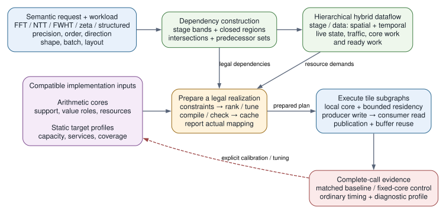

# cuButterfly

**Hierarchical hybrid dataflow for butterfly computation on GPUs.**

[](https://github.com/TruNcat3/cuButterfly/actions/workflows/repository-checks.yml)
[](LICENSE)
[](CITATION.cff)

cuButterfly is a CUDA research library for FFT, NTT, FWHT, structured 2×2,
and subset/superset zeta transforms. It derives local work and communication
from butterfly dependencies, then combines spatial expansion and temporal
reuse under hardware constraints. Compatible arithmetic cores remain
replaceable; a single-band transform is also a valid organization.
The [v0.9 overview](docs/release_v09.md) describes the framework and public interfaces.

<p align="center">
  <strong>Teng Wang</strong><br>
  High Efficient Intelligent Computing Lab<br>
  <a href="https://sz.ustc.edu.cn/en/index.html">Suzhou Institute for Advanced Research,
  University of Science and Technology of China</a> · Suzhou, China<br>
  <a href="mailto:wangt635@ustc.edu.cn">wangt635@ustc.edu.cn</a>
</p>

Author affiliation, software citation and third-party attribution are maintained
in [Project and authorship](docs/about.md), [CITATION.cff](CITATION.cff) and
[third-party notices](THIRD_PARTY_NOTICES.md). This is independently maintained
research software, not an institutional release.

## Start with your task

| Task | Entry |
| --- | --- |
| Install and call the library | [Getting started](docs/getting_started.md) → [Public planner](docs/unified_planner.md) → [Support contract](docs/support_matrix.md) |
| Understand the method | [Design overview](docs/design_overview.md) → [Research principles](docs/research_principles.md) → [Design space](docs/butterfly_design_space.md) |
| Extend an operator, core or platform | [Engineering map](docs/development/repository-layout.md) → [Contributing](CONTRIBUTING.md) |
| Calibrate or tune a GPU | [Hardware workflow](docs/hardware_profile_install.md) → [Target runbooks](docs/hardware/README.md) |
| Run a comparison | [Benchmark guide](benchmark/README.md) → [Reporting protocol](docs/reporting_contract.md) |
| Read the paper and evidence | [Paper](paper/main.pdf) → [Paper guide](paper/README.md) → [Experimental results](docs/benchmarks/results.md) |

The [documentation index](docs/README.md) provides the complete reading routes.
The [archive](docs/archive/README.md) preserves version history and research records.

## Research method and engineering

A fast local core still depends on data supply, storage capacity, communication
and concurrency. Roofline bounds the available performance, but does not
choose how dependent stages and data regions should execute. cuButterfly
studies that organization problem across butterfly arithmetic families.

1. **Derive local work and handoffs.** Stage dependencies define closed regions;
   their intersections identify exchanged values and consumer predecessors.
2. **Characterize resource demand.** Stage and data dimensions admit spatial
   expansion and temporal reuse. Their combination determines live state,
   communication, arithmetic work and ready work at each storage scope.
3. **Execute tile subgraphs.** Bind legal regions to compatible cores and bounded
   storage. Producer writes and consumer reads jointly determine boundary
   placement; publication and buffer reuse preserve dependencies.

The same construction repeats across storage scopes. Its winning partition,
core, layout and pipeline depth may differ by arithmetic, precision, workload
and hardware. More residency or overlap need not improve every request.

<p align="center">
  
</p>

The [editable diagram](figures/cubutterfly_concept.dot) separates the method from
its engineering pipeline. Calibration supplies target-local observations;
selection, compilation and caching prepare executable plans. These mechanisms
support the research method and are not separate novelty claims. Warm execution
excludes preparation; required permutations, conversions and normalization stay
inside the complete-call timing boundary.

## Installation and first checks

Use a CUDA toolkit and compiler compatible with the target GPU. Follow
[Getting started](docs/getting_started.md) for a shared-library installation,
Python descriptor validation and the public execution interface. The installer
can detect the target and reuse compatible static profiles. Refresh and tuning
are explicit operations; a bounded calibration is not exhaustive optimization.

On an existing checkout, these checks need no GPU:

```bash
python scripts/check_repository.py
python -m benchmark.manifest config/benchmark_quick.json --mode quick \
  --output /tmp/cubutterfly-quick-manifest.json
```

Use the Python environment selected for installation. Manifest expansion records
requested cases without executing GPU workloads. See the
[benchmark guide](benchmark/README.md) for measurement and reproduction.

## Capability and evidence scope

A request combines operator semantics with precision, direction, normalization,
input/output order, rank, shape, batch, placement and strides. The
[support contract](docs/support_matrix.md) distinguishes a valid request from an
implemented, compiled, measured or selected realization. Adapters retain full
conversion costs; unavailable combinations remain explicit.

Evaluation covers three complementary questions:

| Experiment | Question |
| --- | --- |
| Operator comparisons | How do complete generated transforms compare with specialized libraries? |
| Controlled organization experiments | What changes when the arithmetic core is held fixed, and which resource effects explain it? |
| Applications | How much of the transform benefit reaches a complete application under matched invocation and output contracts? |

[Experimental results](docs/benchmarks/results.md) report the measured domains,
protocols and limitations, including negative results. The common method permits
different winning organizations; it does not require every mechanism to help
every request.

[Ascend-FFT](https://github.com/TruNcat3/ascend-fft) and
[Kunlunxin-FFT](https://github.com/TruNcat3/kunlunxin-fft) are independent
lowerings of the method to Huawei Ascend and Kunlunxin P800, respectively.
Their hardware-specific kernels, interfaces and measurements belong to their
own repositories. See [platform ports](docs/platform_ports.md) for the
relationship; their results are not pooled with CUDA comparisons.

## Citation and license

Use [CITATION.cff](CITATION.cff) for software metadata. The paper draft and the
software release have distinct version identities. Cite the independent
Kunlunxin port separately when using its implementation or measurements.

```bibtex
@software{wang_cubutterfly_2026,
  author       = {Teng Wang},
  title        = {cuButterfly: Hardware-Mapped Space-Time Parallelism for Butterfly Computations on GPUs},
  year         = {2026},
  version      = {0.9.0},
  url          = {https://github.com/TruNcat3/cuButterfly},
  organization = {High Efficient Intelligent Computing Lab,
                  Suzhou Institute for Advanced Research,
                  University of Science and Technology of China}
}

@software{wang2026kunlunxinfft,
  author       = {Teng Wang},
  title        = {Kunlunxin-FFT: A Hardware-Mapped FFT Operator Library for Kunlunxin P800},
  year         = {2026},
  url          = {https://github.com/TruNcat3/kunlunxin-fft},
  organization = {High Efficient Intelligent Computing Lab,
                  Suzhou Institute for Advanced Research,
                  University of Science and Technology of China}
}
```

The latter entry is the citation for the independent platform port; it does
not turn its measurements into cuButterfly CUDA evidence.

The [Research-Only Non-Commercial License](LICENSE) permits the uses stated
there; commercial use requires a separate license. Third-party components retain
their [own notices and licenses](THIRD_PARTY_NOTICES.md).
